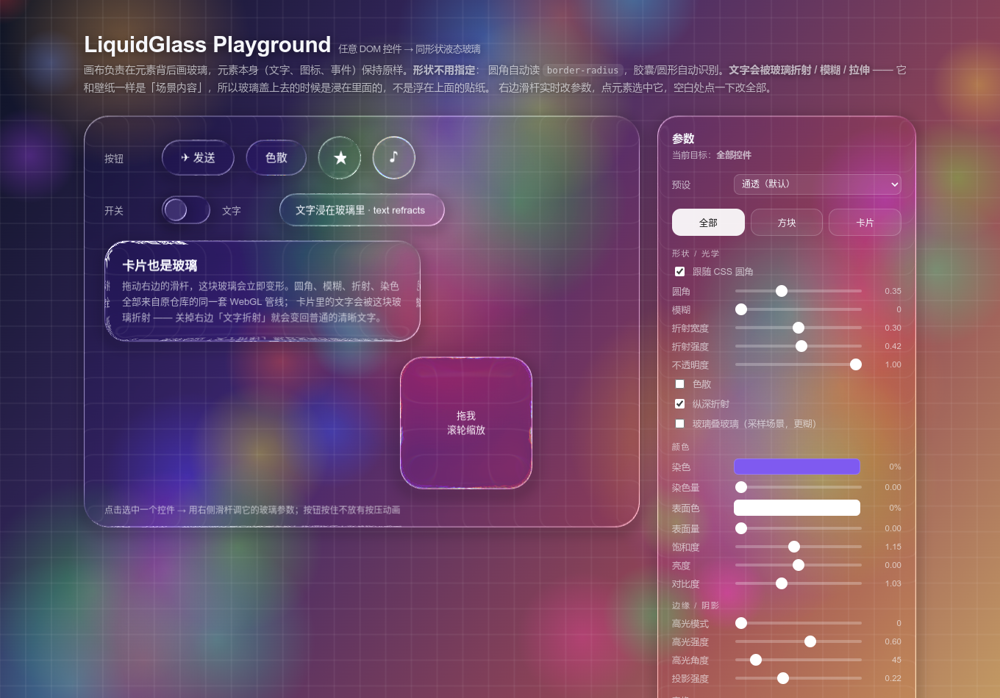

# LiquidGlass

**Turn any DOM element into beautiful liquid glass with pure WebGL.**

[](./LICENSE)
[](./src)
[](./index.html)

> Based on [martin65536/liquid-glass-webgl](https://github.com/martin65536/liquid-glass-webgl) (Apache-2.0)  
> Original inspiration: [Kyant0/AndroidLiquidGlass](https://github.com/Kyant0/AndroidLiquidGlass)



---

## Why LiquidGlass?

Most "glassmorphism" libraries just blur the background with CSS.  
**LiquidGlass** is different:

- Real **WebGL refraction**, chromatic aberration, depth effects
- Automatically reads your element's `border-radius` (capsule / circle / rounded rect)
- Text can be **refracted inside the glass** (not just floating on top)
- Smooth spring animations (enter + press feedback)
- Multiple presets: `clear` / `liquid` / `frosted` / `heavy` / `chromatic`
- Drop-in: just add `data-liquid-glass` and one line of JS

Perfect for modern UI, landing pages, dashboards, or just showing off.

---

## Quick Start

```html
<script src="./dist/liquid-glass.js"></script>

<div class="btn" data-liquid-glass>Click me</div>

<script>
  const glass = new LiquidGlass({
    wallpaper: './wallpaper.jpg'   // or a color / canvas / video
  });
  glass.scan();   // make every [data-liquid-glass] into liquid glass
</script>
```

Or with options:

```html
<div data-liquid-glass='{"blur":12,"refractionAmount":50,"chromaticAberration":true}'>
  Fancy glass
</div>
```

ESM:

```js
import { LiquidGlass } from './dist/liquid-glass.esm.js';
```

---

## Features

| Feature | Description |
|--------|-------------|
| **Auto shape** | Reads CSS `border-radius` automatically |
| **Text refraction** | Text gets distorted by the glass (immersive mode) |
| **Spring animations** | Enter animation + press feedback with glow |
| **Presets** | `clear` (default), `liquid`, `frosted`, `heavy`, `chromatic` |
| **Full control** | Blur, refraction, tint, highlight, shadow, scale, rotation... |
| **Glass stacking** | Optional true glass-over-glass refraction |
| **Performance** | Dirty flag + auto sleep when idle |

---

## Live Demo

Open [`index.html`](./index.html) for the full **Glass Playground**:

- Drag, scale, rotate elements
- Live parameter panel
- Switch presets & wallpapers
- FPS monitor

Minimal example: [`examples/minimal.html`](./examples/minimal.html)

---

## Installation

```bash
npm install      # only needs esbuild for building
npm run build    # generates dist/liquid-glass.js / .min.js / .esm.js
```

Or just download the files from `dist/` and use them directly.

---

## API Overview

```js
const glass = new LiquidGlass({
  preset: 'clear',          // or 'liquid' | 'frosted' | 'heavy' | 'chromatic'
  animateIn: true,
  interactive: true,        // press animation
  refractText: true,        // text goes through glass
  wallpaper: './bg.jpg',
  dpr: Math.min(devicePixelRatio, 2)
});

glass.scan();                         // auto-detect [data-liquid-glass]
glass.add('#my-button', { blur: 8 });
glass.update('#my-button', { tintColor: 'rgba(0,120,255,.3)' });
glass.setPreset('liquid');
glass.setWallpaper('#0a1628');
```

See the original Chinese README below or the source for the full parameter list.

---

## License

Apache-2.0  
Renderer / shaders / geometry algorithms belong to the upstream authors.  
See [`NOTICE.md`](./NOTICE.md) for detailed attribution.

---

## Credits

- Rendering pipeline: [martin65536/liquid-glass-webgl](https://github.com/martin65536/liquid-glass-webgl)
- Original concept: [Kyant0/AndroidLiquidGlass](https://github.com/Kyant0/AndroidLiquidGlass)

---

<br>

# 中文说明（完整版）

把 [martin65536/liquid-glass-webgl](https://github.com/martin65536/liquid-glass-webgl)（Apache-2.0）的 WebGL 渲染管线**原样搬过来**，加上一层 vanilla 宿主，做成一个可以直接 `<script>` 引入的库。

```html
<script src="./dist/liquid-glass.js"></script>
<div class="btn" data-liquid-glass>按钮</div>
<script>
  const glass = new LiquidGlass({ wallpaper: './wallpaper.jpg' });
  glass.scan();                 // 页面上所有 [data-liquid-glass] 全部变玻璃
</script>
```

> 上游项目：[martin65536/liquid-glass-webgl](https://github.com/martin65536/liquid-glass-webgl) ·  
> 更上游：[Kyant0/AndroidLiquidGlass](https://github.com/Kyant0/AndroidLiquidGlass)（Kotlin/Compose）  
> 许可证：Apache-2.0。渲染器 / 着色器 / G2 几何都是他们的代码，详见 [`NOTICE.md`](./NOTICE.md)。


## 特点

- **不用指定形状**：圆角自动读元素的 CSS `border-radius`，胶囊 / 圆形自动识别；  
  元素本身（文字、图标、事件、动画）保持 DOM 原样，画布只在它背后画同形状的玻璃。
- **文字会被玻璃折射**（`refractText`，默认开）：元素里的文字会被当成「场景内容」交给渲染器绘制，于是玻璃采样场景时会把文字一起折射 / 模糊 / 拉伸 —— 看得见字在玻璃里面，而不是浮在玻璃上面的贴纸。关掉它（`refractText: false`）就回到「DOM 文字永远清晰、压在玻璃之上」的老行为。
- **默认预设「通透」**：`blur: 0`（原版玻璃游乐场的初始值就是不糊）+ 强折射带 + 1px 高光描边 + 投影。玻璃的"存在感"来自边缘的折射/高光，而不是把背景糊白。
- **动画**（都走原仓库的弹簧与渲染器能力）：
  - **入场动画**：0→1 弹簧，淡入 + 从 0.9 弹到 1 + 轻微上浮，`enterStagger` 按注册顺序错峰；
  - **按压动画**：`interactive: true` 的元素按原仓库 `button` 处理 —— 按下玻璃放大 `1+4/48`、手指处出现白色辉光、跟手位移（tanh）、松手欠阻尼回弹；
  - 拖动 / 滚动 / 改参数每帧同步，静止时自动休眠。
- **预设**：`clear`（通透，默认）/ `liquid`（液态）/ `frosted`（磨砂）/ `heavy`（厚重）/ `chromatic`（色散），一句 `glass.setPreset('liquid')` 全局换，也可以只换一个元素。
- **自由调参**（就是原版「玻璃游乐场」的那套参数）：  
  圆角、模糊、折射宽度、折射强度、不透明度、色散、纵深折射、染色、表面色、饱和度 / 亮度 / 对比度、边缘高光（模式 / 强度 / 角度 / 宽度）、投影、旋转、缩放。
- **玻璃叠玻璃**：`independentBackdrop: false` 时玻璃采样合成后的场景，后面的玻璃会折射前面的玻璃（默认 `true`：只采样壁纸，更通透也更快）。
- **实时**：拖动滑杆 / 移动元素 / 滚动页面都能立刻跟上；无变化时渲染器自动空转休眠。
- 原版渲染器的全套能力都在（Kawase 模糊、每元素 FBO、模糊缓存、DPR / 降采样档位…）。

## 快速开始

```html
<script src="./dist/liquid-glass.js"></script>
<script>
  const glass = new LiquidGlass({
    dpr: Math.min(devicePixelRatio, 2),
    wallpaper: { type: 'canvas', source: myCanvas }   // 或 './wallpaper.jpg' / {type:'color', color:'#123'}
  });
  glass.scan();                        // 登记 [data-liquid-glass] / [data-lg]
  glass.add('#send', { blur: 8 });     // 或手动登记（形状照样自动）
  glass.update('#send', { refractionAmount: 60, tintColor: 'rgba(0,120,255,.35)' });
  glass.setParam('dpr', 1.5);          // 全局参数
</script>
```

属性写法（值是 JSON）：

```html
<div data-liquid-glass='{"blur":16,"refractionAmount":40,"chromaticAberration":true}'>…</div>
```

ESM：

```js
import { LiquidGlass } from './dist/liquid-glass.esm.js';
```

## API

### `new LiquidGlass(options)`

| 选项 | 默认 | 说明 |
| --- | --- | --- |
| `preset` | `'clear'` | 观感预设，见下 |
| `animateIn` | `true` | 入场动画（弹簧淡入 + 微缩放 + 轻微上浮） |
| `enterStagger` | `45` | 入场延迟（ms/个），按注册顺序错峰 |
| `interactive` | `true` | 按压动画（弹簧缩放 1+4/48 + 手指处白色辉光 + 松手回弹） |
| `refractText` | `true` | 文字折射（沉浸模式），见下 |
| `wallpaper` | `null` | 壁纸，见下 |
| `dpr` | `2` | 渲染分辨率倍率（原渲染器默认按 `devicePixelRatio` 上限 3） |
| `zIndex` | `-1` | 画布层级：在页面背景之上、正文之下 |
| `pageBackground` | `'transparent'` | 自动把 `html/body` 背景让给壁纸（否则 body 背景会盖住负 z-index 画布）。想保留页面背景就设 `false` |
| `autoScan` | `true` | 启动时扫描 `[data-liquid-glass]` |
| `autoStart` | `true` | 自动开 rAF 循环 |
| `cornerStyle` | `1` | 0 = 圆弧角，1 = 连续曲率（默认） |
| `blurTapCap` | `16` | 模糊采样数上限 |
| `blurDownsample` | `2` | 模糊降采样档位（1 = 最高质量最慢） |
| `useKawaseBlur` | `true` | 用 Kawase 模糊（更快） |
| `usePerElementFbo` | `true` | 每元素 FBO（更快、更清晰） |
| `directBackdropSample` | `false` | 见「玻璃叠玻璃」 |
| `className` | `'lg-glass'` | 登记后加在元素上的 class |

### 方法

| 方法 | 说明 |
| --- | --- |
| `add(target, params?)` | 登记元素（选择器 / DOM 节点），返回记录 |
| `update(target, params)` | 改某个元素的参数（合并） |
| `updateAll(params)` | 改所有已登记元素的参数（合并） |
| `setParam(name, value)` | 改全局默认值 + 渲染器全局参数 |
| `setPreset(name, target?)` | 换预设（不传 target = 全部元素） |
| `paramsOf(target)` | 读某个元素「实际生效」的参数（预设 + 全局 + 覆盖合并后） |
| `intro()` | 重播全部元素的入场动画 |
| `press(target, pressed, position?)` | 脚本驱动按压弹簧（DOM 事件已自动接好，一般不用手动调） |
| `remove(target)` / `get(target)` / `scan(root?)` / `refresh()` | 常用管理 |
| `setWallpaper(wp)` / `setBackgroundColor(cssColor)` | 换壁纸 |
| `start()` / `stop()` / `renderNow()` / `resize()` / `destroy()` | 生命周期 |
| `glass.renderer` | 原仓库的 `LiquidGlassRenderer` 实例，可直接使用它的全部能力 |

### 元素参数（`add` / `update` / `data-liquid-glass`）

| 参数 | 默认 | 说明 |
| --- | --- | --- |
| `preset` | `'clear'` | 该元素单独的预设（覆盖全局） |
| `shape` | `'auto'` | `auto`（读 CSS 圆角）/ `capsule` / `circle` / `rect` |
| `radius` | – | 直接指定圆角（CSS px） |
| `radiusFraction` | `null` | 0~1，乘以 `min(w,h)/2`（`0.5` = 胶囊） |
| `blur` | `0` | 背景模糊半径（px）；`0` = 完全不糊（通透） |
| `refractionHeight` | `null` | 折射带宽度（px，绝对） |
| `refractionAmount` | `null` | 折射位移量（px，绝对，越大边缘越"厚"；内部按负号传给渲染器） |
| `refractionHeightFraction` | `0.3` | 折射带宽度 = 比例 × `min(w,h)/2` |
| `refractionAmountFraction` | `0.42` | 折射位移量 = 比例 × `min(w,h)` |
| `chromaticAberration` | `false` | 7 通道色散（边缘彩虹） |
| `depthEffect` | `true` | 纵深折射（凸透镜感） |
| `animateIn` | `true` | 该元素是否参与入场动画 |
| `enterOffset` | `6` | 入场时玻璃从下方几 px 滑到位（DOM 不动） |
| `interactive` | `true` | 按压动画（弹簧缩放 + 手指辉光 + 回弹） |
| `refractText` | `true` | 该元素的文字是否交给渲染器、从而被玻璃折射 |
| `keepLook` | `false` | `true` = 保留自己的观感参数，`updateAll()` / 全局 `setPreset()` 不动它（大背景板建议开） |
| `opacity` | `1` | 玻璃整体不透明度（0 = 完全透明）。纯 alpha，元素不会位移 |
| `tintColor` | `null` | 染色，任意 CSS 颜色（alpha 即强度） |
| `surfaceColor` | `null` | 表面底色（奶白 / 磨砂感） |
| `saturation` / `brightness` / `contrast` | `1.15` / `0` / `1.03` | 背景色彩处理（不糊的时候别再把饱和度推高） |
| `highlight` | 原版默认 | `{ mode:0\|1\|2, color, angleDeg, falloff, alpha, widthDp }`，传 `false` 关闭 |
| `outerShadow` | 原版默认 | `{ radius, alpha, offsetX, offsetY, color }`，传 `false` 关闭 |
| `innerShadow` | `null` | `{ radius, alpha, offsetX, offsetY, color }` |
| `rotation` | `0` | 旋转（度） |
| `scale` | `1` | 视觉缩放（不改变玻璃纹理分辨率） |
| `capsuleShape` | `false` | 用 G2 连续曲率 SDF 纹理做形状（更精确，但每个尺寸一张纹理） |
| `independentBackdrop` | `true` | `true` = 只采样壁纸（通透、可缓存、快）；`false` = 采样场景（可以玻璃叠玻璃） |

> 折射参数有「绝对值」和「比例」两套：`refractionAmount: 40` 是写死 40px；  
> `refractionAmountFraction: 0.42` 是 `0.42 × min(w,h)`，大卡片和小胶囊观感一致 —— 原版玻璃游乐场用的就是比例。两个都给时绝对值优先。

### 壁纸

```js
glass.setWallpaper('./wallpaper.jpg');                          // 图片
glass.setWallpaper('#12203a');                                  // 纯色
glass.setWallpaper({ type: 'color', color: '#12203a' });
glass.setWallpaper({ type: 'canvas', source: myCanvas });       // 任意 canvas（可每帧更新）
glass.setWallpaper({ type: 'video', src: './loop.mp4' });       // 视频做折射源
glass.setWallpaper({ type: 'draw', draw(ctx, w, h, t) { … } }); // 自己画（默认静态）
```

## 预设

| 名字 | 观感 |
| --- | --- |
| `clear` | **通透（默认）**：不糊、折射强、一圈 1px 高光描边 + 投影 |
| `liquid` | 液态：折射最猛 + 色散 + 纵深，适合方块 / 球体这种展示件 |
| `frosted` | 磨砂：厚模糊 + 弱折射，雾面感 |
| `heavy` | 厚重：磨砂 + 表面底色 + 内阴影，像一块厚玻璃板 |
| `chromatic` | 色散：通透 + 边缘彩虹 |

```js
glass.setPreset('liquid');                 // 全部元素
glass.setPreset('frosted', '#card');       // 只换卡片
```

预设只是「一组观感参数」，`update()` / `setParam()` 里显式给的值优先级更高  
（顺序：默认值 → 预设 → 全局显式覆盖 → 元素自己的参数）。

## 文字折射（沉浸模式）

```js
glass.setParam('refractText', false);                 // 全局关掉
glass.updateAll({ refractText: false });
glass.update('#panel', { refractText: false });       // 只让某块玻璃的字保持清晰
```

它是怎么做的：宿主用 `Range.getClientRects()` 把元素里的文字按**浏览器自己的行盒**切出来，逐行生成原仓库 `catalog` 里那种 `kind: 'text'` 元素，放进场景的**最底层**（在所有玻璃之前），然后把 DOM 里的那份文字设成透明（只改颜色，文字仍在 DOM 里，选中 / 复制 / 读屏都不受影响）。玻璃在这之后就采样场景，于是文字跟着壁纸一起被折射。

代价与边界（都写在 `NOTICE.md` 里）：

- 可见的那份文字由渲染器的 Canvas2D 栅格化，字体栈是上游写死的那一套（`-apple-system, …, Arial, sans-serif`）—— 页面的 CSS 字体请尽量与之一致，否则字形会有一点点不同；
- 文字折射开启时玻璃必须采样「场景」，不能只采样壁纸（只采样壁纸会把底下的文字盖掉），所以会放弃一部分缓存加速；
- 表单控件（`button` / `input` / `select` / `option`）里的文字不接管，保持浏览器原生渲染；
- 比画布还高的元素（超长面板）建议 `refractText: false`：渲染器的每元素 FBO 会碰到尺寸边界，文字可能被画歪；面板这类控件保持 DOM 原生文字反而更清楚；
- 折射带宽度是 `fraction × min(w,h)/2`：一块铺满整屏的大玻璃会得到非常宽的折射带，把里面的内容搅烂。大背景板请用很小的 fraction（或绝对 px），并给它 `keepLook: true`，免得被全局滑杆/预设改掉；
- 旋转过的元素（`rotation ≠ 0`）和 `scale < 1`（玻璃比文字小一圈）保留 DOM 文字，因为行盒 / 尺寸对不上会产生重影；
- 采样方式会自动选：**盖住文字的玻璃**采样场景（这样字才能透过玻璃被折射），没盖住文字的玻璃继续"只采样壁纸"（更通透、更快，也不会被上一层玻璃的模糊糊掉）；
- 玻璃开了 `blur` 时文字会跟着糊 —— 这正是「雾面玻璃盖住内容」该有的样子；想看清字就把这块玻璃的 `blur` 调到 0（默认预设「通透」就是 0）。

## 动画

```html
<!-- 按压动画：按住玻璃会弹、手指处有辉光、松手回弹 -->
<div class="btn" data-liquid-glass='{"interactive":true}'>发送</div>
```

```js
glass.intro();                        // 重播入场动画（全部元素）
glass.update('#card', { animateIn: false });   // 某个元素不要入场动画
glass.update('#ball', { interactive: true });  // 让某个元素可按压
glass.press('#ball', true, { x: 300, y: 200 }); // 脚本触发按压（不点鼠标也行）
```

- 入场：宿主每帧推进一个弹簧（ω≈15.5、ζ≈0.74），把值喂给渲染器的 `enterProgress`，同时乘进 `elementScaleX/Y`；`enterStagger` 让同一批登记的元素依次进场。
- 按压：`interactive` 默认为 `true`，所以**任何**登记过的元素（按钮、卡片、面板、方块…）按下去都有反馈。DOM 事件在 `document` 捕获阶段统一监听 → `renderer.setPressed()/setDragPosition()`，之后的弹簧、辉光、跟手位移、回弹全部是原仓库渲染器自己的代码。
- 文字元素和玻璃元素共用同一套入场数值，所以进场过程中字不会跟玻璃错位。

## 玻璃游乐场（`index.html`）

- 舞台上的每个控件（胶囊按钮、圆形按钮、DOM 开关、卡片、可拖拽方块、鼠标跟随玻璃）都只是普通元素 + `data-liquid-glass`；
- 点某个控件 → 右侧面板改它的参数；点空白 → 改全部；
- 方块可以拖动、滚轮缩放、滑杆旋转，并默认自动漂浮（DOM 动、玻璃每帧跟）；
- 按钮按住不放有按压动画；
- 面板本身也是玻璃（可以勾「玻璃叠玻璃」看场景采样）；
- 还能切预设 / 壁纸 / 动态光斑、改 DPR / 模糊降采样 / Kawase / 每元素 FBO，右下角有 FPS。

## 小贴士：去掉点击时的虚线框

浏览器默认的焦点框（Firefox 的点线、某些场景下的虚线）画在玻璃上特别显眼。库本身**不注入**任何 `outline` 规则 —— 那会伤键盘可访问性 —— 需要的话在自己的页面里加：

```css
button, input, select, a, [data-liquid-glass] {
  outline: none;                            /* 去掉默认虚线框 */
  -webkit-tap-highlight-color: transparent; /* 去掉移动端点击蓝框 */
}
/* 键盘用户仍然知道焦点在哪 */
button:focus-visible, input:focus-visible, select:focus-visible {
  outline: none;
  box-shadow: 0 0 0 2px rgba(255,255,255,.5);
}
```

演示页里的「选中某个控件」反馈也换成不带边框的做法了：点一下扩散并淡出的一圈柔光环（`.sel` + `lg-sel-pulse` 动画），不再常驻虚线。

## 性能

- 渲染器自带脏标记：参数签名不变就不重绘；宿主每帧只做一次「读 rect + 比较」。
- 静态壁纸下只有元素几何 / 参数变化 / 动画在跑才触发 WebGL 重绘；实测静止后 2 秒内重绘 0~1 次。
- 动态壁纸（canvas / video）每帧上传纹理；鼠标跟随玻璃 / 漂浮方块这类「DOM 一直在动」的演示会持续重绘。
- 大屏建议 `dpr: 1.5`；元素很多时把 `blur` 调小或关掉色散（色散让采样数 ×7）。

## 限制

- 渲染器的 `cornerRadius` 是**统一圆角**：元素四角半径不同时取最大值（详见 `NOTICE.md`）。
- 玻璃折射的是壁纸层，不是任意 DOM 内容（也正因为如此，文字永远不会被折射）。
- 需要 WebGL1；不支持时 `new LiquidGlass()` 会抛错，建议 try/catch 降级到 CSS。
- 按压动画要求元素在登记时（或 `update` 时）设了 `interactive: true`；此时渲染器把元素当 `button` 处理。

## 重新打包

```bash
npm install      # 只装 esbuild
npm run build    # 输出 dist/liquid-glass.js / .min.js / .esm.js
```

## 许可证

Apache-2.0。渲染管线、着色器、几何算法版权归上游作者所有（见 `NOTICE.md` / `LICENSE`）。
